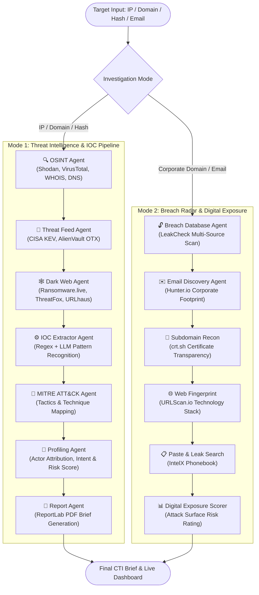

# 🧠 CorteX AI

<div align="center">

### **Autonomous Agentic Cyber Threat Intelligence (CTI) & Digital Exposure (OSINT) Platform**

[](https://www.python.org/)
[](https://github.com/langchain-ai/langgraph)
[](https://streamlit.io/)
[](https://ollama.com/)
[](https://attack.mitre.org/)
[](LICENSE)

[Architecture](#-multi-agent-architecture) •
[Investigation Modes](#-dual-investigation-modes) •
[Integrated Sensors & Feeds](#-integrated-threat-sensors--tools) •
[Quick Start](#-quick-start) •
[Project Structure](#-project-structure) •
[License](#-license)

</div>

---

## 📌 Overview

Modern Security Operations Centers (SOCs) and Threat Intelligence teams struggle with the manual effort required to investigate potential indicators of compromise (IOCs) and corporate credential leaks. Analysts spend hours manually pivoting between port scanners, reputation engines, WHOIS databases, dark web scrapers, and paste repositories.

**CorteX AI** automates this end-to-end investigation workflow through an **autonomous multi-agent system** orchestrated by **LangGraph**. Given a target (IP address, domain, file hash, or employee email), CorteX AI deploys specialized AI agents to execute reconnaissance, cross-reference live threat databases, extract indicators, map tactics to the **MITRE ATT&CK** matrix, assess threat actor attribution, and compile executive-ready PDF intelligence briefings.

---

## 🏛️ Multi-Agent Architecture

CorteX AI organizes specialized autonomous agents into a stateful, cyclic directed graph via **LangGraph**:



---

## 🎯 Dual Investigation Modes

### 1. Threat Intelligence Mode (Target: IP, Domain, Hash)
* **OSINT Recon**: Queries Shodan for open ports, running services, SSL certificates, and vulnerabilities. Validates file and URL reputations across 70+ antivirus engines via VirusTotal. Performs deep WHOIS and DNS lookups.
* **Threat Feed Enrichment**: Cross-references against the **CISA Known Exploited Vulnerabilities (KEV)** catalog and pulls live threat pulses from **AlienVault OTX**.
* **Dark Web Sweep**: Scans active ransomware leak sites via **Ransomware.live**, malware feeds via **ThreatFox**, and malicious payload distribution servers via **URLhaus**.
* **Autonomous IOC Extraction**: Automatically identifies and defangs IPs, domains, hashes, and URLs embedded across all agent outputs using heuristic regex and LLM entity extraction.
* **MITRE ATT&CK Mapping**: Maps observed behaviors and IOC metadata directly to ATT&CK tactics (Initial Access, Execution, Persistence, Defense Evasion, Command & Control).
* **Actor & Target Profiling**: Evaluates threat actor intent, capability level, infrastructure overlap, and computes an aggregate Threat Rating (Low, Medium, High, Critical).
* **Automated PDF Report Generation**: Synthesizes all forensic findings into a formatted, production-grade PDF threat briefing.

### 2. Breach Radar Mode (Target: Domain, Email)
* **Credential Breach Discovery**: Scans compromised credential leaks across billions of breached records via **LeakCheck** and **Hunter.io**.
* **Subdomain Enumeration**: Discovers exposed subdomains and shadow infrastructure via Certificate Transparency logs (**crt.sh**).
* **Technology Fingerprinting**: Identifies web frameworks, headers, and server signatures via **URLScan.io**.
* **Paste & Leak Site Surveillance**: Performs real-time paste site surveillance via **IntelX**.
* **Attack Surface Risk Score**: Calculates digital exposure ratings to evaluate credential spill risks and corporate attack surfaces.

---

## 🛠️ Integrated Threat Sensors & Tools

| Source / Tool | Category | Capability |
|---|---|---|
| **Shodan** | Network Recon | Open ports, banners, running services, CVEs |
| **VirusTotal v3** | Malware Analysis | Multi-engine antivirus detection ratios, reputation scores |
| **AlienVault OTX** | CTI Feed | Crowd-sourced threat pulses, targeted malware campaigns |
| **CISA KEV** | Vulnerability Intel | Actively exploited in-the-wild vulnerabilities |
| **Ransomware.live** | Dark Web | Active extortion victim listings, ransomware groups |
| **ThreatFox & URLhaus** | Threat Intelligence | Verified malware hashes, command-and-control (C2) URLs |
| **Hunter.io** | Identity & OSINT | Corporate email patterns, exposed employee addresses |
| **LeakCheck** | Identity Intelligence | Database breach verification, credential leak histories |
| **URLScan.io** | Web Intelligence | Live webpage DOM captures, redirect chains, IP mappings |
| **crt.sh** | Infrastructure Recon | SSL/TLS certificate transparency subdomain discovery |
| **ReportLab** | Document Generation | High-fidelity CTI PDF report generation |

---

## 🚀 Quick Start

### 1. Prerequisites
- **Python**: 3.10 or higher
- **LLM Engine**:
  - **Option A (Local)**: [Ollama](https://ollama.com/) with `mistral` (`ollama pull mistral`)
  - **Option B (Cloud)**: [Groq Cloud API Key](https://console.groq.com) (free tier available)

### 2. Clone & Install Dependencies
```bash
git clone https://github.com/<your-username>/cortex-ai-threat-intelligence.git
cd cortex-ai-threat-intelligence

# Create virtual environment
python -m venv venv
source venv/bin/activate       # On Linux/macOS
# .\venv\Scripts\Activate.ps1  # On Windows

# Install required packages
pip install -r requirements.txt
```

### 3. Environment Configuration
Copy the sample environment file and configure your API keys:
```bash
cp .env.example .env
```
Open `.env` and fill in your keys (Shodan, VirusTotal, AlienVault OTX, Hunter.io, etc.).

### 4. Launch the Interactive Dashboard
Launch the full-featured Streamlit investigation console:
```bash
streamlit run dashboard.py
```
Open your browser at **`http://localhost:8501`** to start investigating targets.

### 5. Running via CLI / Headless Pipeline
You can also invoke the autonomous LangGraph pipeline programmatically:
```bash
python main.py
```

---

## 📂 Project Structure

```
cortex-ai-threat-intelligence/
├── agents/                       # Specialized AI Agents
│   ├── osint_agent.py            # Shodan, VirusTotal, WHOIS, DNS reconnaissance
│   ├── threat_feed_agent.py      # CISA KEV and AlienVault OTX enrichment
│   ├── darkweb_agent.py          # Ransomware.live, ThreatFox, URLhaus surveillance
│   ├── ioc_agent.py              # Pattern matching & LLM-based IOC extraction
│   ├── mitre_agent.py            # MITRE ATT&CK tactic/technique correlation
│   ├── profiling_agent.py        # Threat actor profiling & risk scoring
│   ├── report_agent.py           # Automated CTI PDF brief generator
│   └── breach_agent.py           # Breach radar & credential exposure agent
├── core/                         # Orchestration & Storage Core
│   ├── cortex_graph.py           # LangGraph StateGraph pipeline definition
│   └── chromadb_store.py         # Vector memory & semantic search store
├── tools/                        # Sensor Tool Integrations & API Clients
│   ├── shodan_tool.py            # Shodan Host API integration
│   ├── virustotal_tool.py        # VirusTotal v3 API integration
│   ├── otx_tool.py               # AlienVault OTX API integration
│   ├── cisa_tool.py              # CISA Known Exploited Vulnerabilities catalog
│   ├── darkweb_tool.py           # ThreatFox, URLhaus, Ransomware.live clients
│   ├── breach_tools.py           # Hunter, LeakCheck, URLScan, IntelX, crt.sh
│   ├── whois_tool.py             # Domain WHOIS and DNS resolution
│   └── ioc_extractor.py          # Defanging and entity extraction utilities
├── reports/                      # Output directory for generated PDF reports
├── dashboard.py                  # Primary Streamlit Interactive Investigation Console
├── dashboard_v1.py               # Legacy dashboard implementation (preserved)
├── main.py                       # CLI invocation entry point for LangGraph pipeline
├── requirements.txt              # Python package dependencies
├── .env.example                  # Environment configuration template
├── LICENSE                       # MIT License
└── ieee.js                       # IEEE Research Paper Document Generator
```

---

## 🔒 Security & Privacy

- **Safe Version Control**: Live API credentials and authentication tokens are kept strictly in `.env`. The project's `.gitignore` prevents secrets, virtual environments, and generated investigation PDF reports from ever being committed to GitHub.
- **Defanged Indicators**: Extracted IOCs are automatically defanged (e.g., `1.1.1[.]1`, `hxxp://...`) to prevent accidental malicious network requests or browser resolution.

---

## 📝 License

Distributed under the **MIT License**. See [`LICENSE`](LICENSE) for details.
